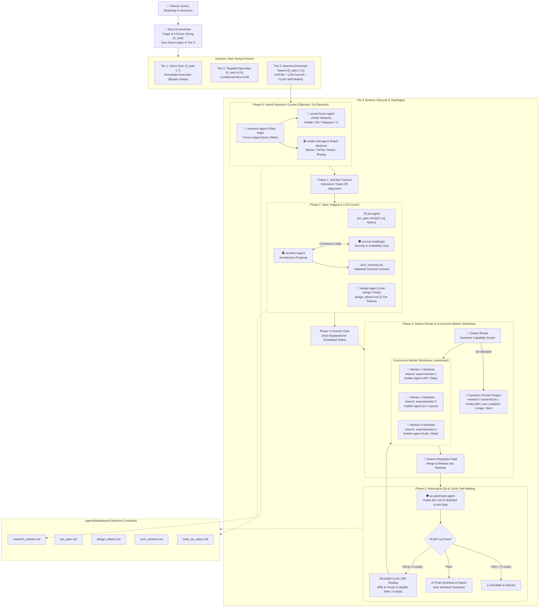
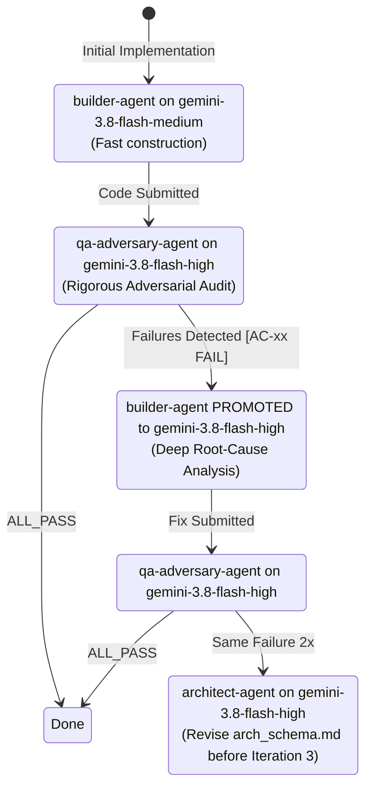

# Wayne Custom Orchestra 🎻

Adaptive Multi-Agent Swarm Orchestrator Architecture & Operating Model (**Wayne Custom 3.0 / Native Swarm Hybrid**).

---

## 🌟 Overview

**Wayne Custom Orchestra** provides an intelligent, tier-based multi-agent coordination system for autonomous software development. It fuses high-level architectural direction with decoupled execution through **dynamic task sizing**, **machine-actionable blackboard contracts**, **criteria-mapped adversarial QA**, and architectural primitives from Kye Gomez's **Swarms framework**:

- **Hierarchical Swarms**: Structured delegation from Root Orchestrator to Core Pillars and Worker Plugins.
- **LLM Council (Consensus Gate)**: Adversarial debate (Proposer vs. Security/Scalability Challenger) before locking architectural contracts.
- **Swarm Router**: Semantic and capability-driven router dynamically activating specialized domain plugins on-demand.
- **Cold Catalog & JIT Skill Retrieval**: Curated foundational catalog (`skills/catalog/`) of 16 indexed skills with offline packages for DOCX, PDF, PPTX, and XLSX, dynamically searchable and mountable via `find_skill.py` with zero root token overhead.
- **Mixture of Agents (MoA)**: Context synthesis flowing downstream from PM, Design, and Architecture directly into Builder.
- **Concurrent Worker Worktrees**: Physical filesystem isolation via Git worktrees (`.worktrees/worker-<id>`) on `swarm/worker-<id>` eliminating file clobbering, git contention, and build lock collisions.
- **Bounded Cyclic Self-Healing**: Automated $\le 3$ iteration feedback cycle between QA Adversary and Builder before escalating to the Director.



---

## 🧬 Swarms Primitives & Topologies

| Swarm Topology | Implementation Mechanism | Workflow Impact |
| :--- | :--- | :--- |
| **Hierarchical Swarm** | `The Orchestrator` $\rightarrow$ Core Pillars $\rightarrow$ Dynamic Plugins | Enforces strict executive oversight with zero direct labor on the root orchestrator. Core pillars lead specialized tracks while dynamic plugins serve as worker nodes. |
| **LLM Council (Consensus Gate)** | Proposer (`architect-agent`) vs. Challenger (`council-challenger`) | Activates during Phase 2. System schemas, data models, and API interfaces must withstand rigorous challenge and reach multi-perspective consensus before locking into `arch_schema.md`. |
| **Hybrid Research Cluster** | Phase 0 Intelligence Sprint (`research-agent`, `social-forum-agent`, `media-intel-agent`) | Ingests cross-lingual technical discourse, developer forums (Reddit, HN, Telegram), and short-form video (Shorts, TikTok, Bilibili) into `research_dossier.md` before planning. |
| **Swarm Router** | Semantic / capability-based dispatcher with Cold Catalog JIT Retrieval | Dynamically provisions plugin subagents (`research-agent`, `social-forum-agent`, `media-intel-agent`, `seo-agent`, `analytics-agent`, `image-agent`, `docs-agent`) and queries `find_skill.py` to mount specialized domain skills just-in-time, keeping root context at 0 token overhead. |
| **Mixture of Agents (MoA)** | Layered contextual synthesis across blackboard | Outputs from PM, Design, and Architecture are synthesized into machine-readable blackboard contracts that guide `builder-agent` directly. |
| **Concurrent Worker Worktrees** | Isolated Git worktrees (`.worktrees/worker-<id>`) on `swarm/worker-<id>` | Activates in Phase 4. Prevents git index contention, compiler cache locks, and file clobbering across concurrent builder instances before merging through the integration gate. |
| **Bounded Cyclic Self-Healing** | Automated loop (`qa-adversary-agent` $\rightleftharpoons$ `builder-agent`) | If adversarial audit detects failing acceptance criteria (`[AC-xx]`), diffs and failure traces are automatically routed back to Builder for up to **3 iterations** before escalation. |
| **Native Swarm Channels & Pub/Sub** | Pub/Sub topic channels (`#council`, `#builders`, `#qa`) via Antigravity Native Swarms | Decouples communications to prevent context dilution, facilitates live multi-agent debate, and exposes real-time visualization to the Director via `narrator` and `monitor`. |

---

## ⚡ Key Capabilities

### 1. Dynamic Task Sizing ($S_{\text{task}}$)
Complexity is calculated across 5 dimensions:
$$S_{\text{task}} = D + F + A + C + V$$
- **$D$ (Domain Breadth)**: Disciplines required (UI, backend, logic, QA).
- **$F$ (Blast Radius & Volume)**: Files touched and line volume.
- **$A$ (Decision Ambiguity)**: Product & design trade-offs.
- **$C$ (Context Dilution Risk)**: Skillset specialization requirements.
- **$V$ (Verification Rigor)**: Test complexity and failure surface.

### 2. Tier-by-Tier Gating
| Tier | Score Range | Mode | Gating Behavior |
| :--- | :--- | :--- | :--- |
| **Tier 1: Micro / Quick Fix** | $S_{\text{task}} \le 7$ | `Direct Solo` | Mandatory bypass of Grill-Me & approval gates. Direct execution. |
| **Tier 2: Targeted Specialist** | $S_{\text{task}} = 8 - 10$ | `Targeted Dispatch` | Single specialist dispatched. Max 1-question micro-grill if UX/arch fork exists. |
| **Tier 3: Swarms-Enhanced Swarm** | $S_{\text{task}} \ge 11$ | `Wayne Custom Swarm` | Full lifecycle: Grill-Me $\rightarrow$ LLM Council Spec Staging $\rightarrow$ Director Gate $\rightarrow$ Swarm Router Dispatch $\rightarrow$ Adversarial QA with Cyclic Self-Healing. |

> **Automated Task Safety Rule**: For any scheduled or timer-triggered tasks (cron, background alarms), the Director approval gate is bypassed ONLY if $S_{\text{task}} \le 10$ (Tier 1 or Tier 2). Tier 3 swarms triggered via unattended timers are automatically constrained to a **50,000 token spend ceiling** and a **maximum of 1 self-healing repair cycle**; if unpassed criteria remain, execution safely halts for Director review.

### 3. The Zero Direct Labor Rule (Tier 3)
For Tier 3 tasks, the root Orchestrator does **no direct code or asset implementation**. It exclusively handles triage, task sizing, LLM Council facilitation, Swarm Router dispatching (`invoke_subagent` or native `swarm` tools with `Workspace: "share"`), self-healing orchestration, and final synthesis.

### 4. Adversarial QA Integrity, Anti-Slop Gating & Cyclic Remediation
`builder-agent` and `qa-adversary-agent` are strictly decoupled. The builder never audits its own code; the adversary validates line-by-line against numbered Acceptance Criteria (`[AC-xx]`) with concrete evidence and executes `impeccable detect (anti-slop audit)` to gate against visual anti-patterns, generic AI templates, and contrast defects. If an issue is flagged, the **Bounded Cyclic Self-Healing Loop** automatically routes the fix up to 3 times before involving the Director.

### 5. Hybrid Native Swarm Execution Mode ($S_{\text{task}} \ge 11$)
Couples Wayne's governance and machine blackboard contracts (`.agents/blackboard/`) with Antigravity Native Swarm's live message board engine:
- **`#council`**: Staged spec review and STRIDE debate between `architect-agent` and `council-challenger`.
- **`#builders`**: Parallel execution across isolated Git worktrees (`.worktrees/worker-<id>`) with shared workspace visibility and standard `[done]` milestone markers.
- **`#qa`**: Adversarial verification against `pm_spec.md`, Regression Lock tracking via `healing_tracker.py`, and surgical remediation tags.
- **Auxiliary Roles**: `narrator` powers the live visual Swarm Overview UI; `monitor` serves as a deadlock watchdog.
- **Channel Controller**: Managed via `scripts/swarm_orchestrator.py`.

### 5. Concurrent Worker Worktree Protocol
When parallel implementation spans multiple builders or independent modules, the Orchestrator enforces filesystem isolation:
1. **Spec-Driven Task Partitioning**: Numbered acceptance criteria (`[AC-xx]`) are partitioned into orthogonal domains (API, UI, Auth, etc.).
2. **Worktree Provisioning**: Each concurrent builder instance is allocated a dedicated worktree under `.worktrees/worker-<id>` on branch `swarm/worker-<id>`.
3. **Concurrent Execution**: Subagents run concurrently via `invoke_subagent`, operating strictly within their designated worktrees to eliminate file clobbering, build cache lockups, and git index contention.
4. **Automated Swarm Integration Gate**: Worker branches are merged or rebased into the integration branch `feat/<task>`, ensuring structural and integration integrity.
5. **Phase 5 QA & Teardown**: `qa-adversary-agent` audits the integrated branch. Once all criteria pass, worktrees are automatically cleaned up (`git worktree remove --force`).

### 6. Cold Catalog & Just-in-Time (JIT) Skill Retrieval
To prevent prompt context bloat while supporting thousands of specialized file formats, protocols, and workflows (e.g. Word `.docx`, PDF forms, Excel `.xlsx`, EPUB publishing, OpenAPI schemas, GitHub Actions, Kubernetes), the workspace implements a two-tier **Cold Catalog & Just-in-Time (JIT) Retrieval Architecture**:

1. **Cold Storage Catalog (`.agents/skills/catalog/`)**:
   - Monolithic domain skills reside cold on disk and in curated `index.json`, completely excluded from agent prompt contexts.
   - Offline starter skills (`docx`, `pdf`, `pptx`, `xlsx`, `_template`) are pre-cached locally for offline speed.
2. **Fast Semantic Search (`find_skill.py`)**:
   - The Orchestrator or Swarm Router queries `.agents/scripts/find_skill.py` via CLI to find matching skills without loading them into memory:
   ```bash
   # Search for domain capabilities
   python3 .agents/scripts/find_skill.py docx
   python3 .agents/scripts/find_skill.py --category devops
   python3 .agents/scripts/find_skill.py --fetch pptx
   ```
3. **Dynamic Subagent Mounting**:
   - Discovered skills are mounted strictly into the target subagent's prompt and workspace during `invoke_subagent`:
   ```python
   invoke_subagent(
       TypeName="docs-agent",
       Role="Docs (DOCX Specialist)",
       Workspace="share",
       Prompt="Follow domain skill instructions at .agents/skills/catalog/docx/SKILL.md to execute the task."
   )
   ```
4. **Zero Direct Root Token Overhead**:
   - Root Orchestrator and Core Pillars maintain **0 token overhead** from specialized skills, ensuring full cognitive capacity and attention preservation for coordination.

### 7. Programmatic vs. Heuristic Architecture Taxonomy

To maintain engineering rigor and avoid conflating prompt suggestions with code guarantees, the orchestrator delineates all capabilities into two distinct operational classes:

| Class | Mechanism Type | Enforcing Artifact / Tool | Failure Behavior |
| :--- | :--- | :--- | :--- |
| **Code-Enforced** | Deterministic CLI scripts, Git hooks, filesystem locks | `worktree_helper.sh`, `validate_blackboard.py`, `healing_tracker.py`, `collate_telemetry.py`, `on_session_start.py` (`hooks.json`) | Hard exit code $\ne 0$; blocks subsequent phases loudly. |
| **Prompt-Guided** | Cognitive role directives, persona constraints, thinking depth | Agent system prompts (`agents/*.md`), skill guides (`skills/*/SKILL.md`) | Probabilistic; monitored via adversarial review and linter audits (`audit_orchestrator.py`). |

---

## 👥 Agent Roster & Codified Skill Boundaries

To prevent token waste, context dilution, and role-bleed, every agent in the swarm operates within codified **"Good Enough" skill boundaries** and strict **anti-bloat scopes**.

### Core Pillars (Always Active in Tier 3 Swarms)
| Agent | Dedicated Spec | Responsibility | Assigned "Good Enough" Skills | Excluded Skills (Anti-Bloat Boundary) | Model Tier | Thinking Effort |
| :--- | :--- | :--- | :--- | :--- | :--- | :--- |
| **The Orchestrator** | *Root Master Blueprint* | Triage, sizing, dispatch, synthesis. Zero direct labor in Tier 3. | `dispatching-parallel-agents`, `brainstorming` | All direct implementation, UI styling, code editing | **`gemini-3.8-flash-high`** | **High** |
| **`pm-agent`** | [`agents/pm-agent.md`](agents/pm-agent.md) | PRD, acceptance criteria (`[AC-xx]`), user personas. | `writing-plans`, `brainstorming` | Code editing, UI styling, debugging | **`gemini-3.8-flash-high`** | **High** |
| **`design-agent`** | [`agents/design-agent.md`](agents/design-agent.md) | Layout architecture, typography, responsive CSS tokens. | `impeccable`, `design-system` | `animate`, `animate-expo`, `emil-design-eng`, `ui-styling`, code implementation, `brand`, `slides`, `banner-design` | **`gemini-3.8-flash-low`** | **Low** |
| **`architect-agent`** | [`agents/architect-agent.md`](agents/architect-agent.md) | System architecture, API contracts, schema consensus. | Architecture & schema design, API contracts | Frontend CSS, UI styling, browser test tools | **`gemini-3.8-flash-high`** | **High** |
| **`council-challenger`** | [`agents/council-challenger.md`](agents/council-challenger.md) | Consensus challenger: STRIDE security, race conditions, scalability. | Threat modeling, scalability audit, edge-case challenge | Code editing, feature implementation | **`gemini-3.8-flash-high`** | **High** |
| **`builder-agent`** | [`agents/builder-agent.md`](agents/builder-agent.md) | Feature construction, logic wiring, cyclic repair. | `ui-styling`, `modern-web-guidance`, `animate`, `systematic-debugging` | `brand`, `slides`, `canvas-design`, open-ended design discovery | **`gemini-3.8-flash-medium`** *(promoted to `gemini-3.8-flash-high` on repair cycles)* | **Medium** *(promoted to `High`)* |
| **`qa-adversary-agent`** | [`agents/qa-adversary-agent.md`](agents/qa-adversary-agent.md) | Independent auditor against `[AC-xx]` & anti-slop gate. | `a11y-debugging`, `chrome-devtools`, `verification-before-completion`, `impeccable detect (anti-slop audit)` | File writing, creative design, feature implementation | **`gemini-3.8-flash-high`** *(mandatory cognitive parity)* | **High** |

### 🎨 The Lean Design Trinity & Anti-Slop Architecture
The frontend workflow leverages a streamlined, decoupled design stack to achieve bespoke visual quality without saturating prompt context:
- **`impeccable`**: Provides taste, aesthetic direction, optical typography scales, OKLCH color palettes, and anti-AI slop heuristics.
- **`design-system`**: Emits strict 3-tier token contracts (`primitive` &rarr; `semantic` &rarr; `component`) into `design_tokens.md`.
- **`impeccable (CLI & Heuristics)`**: On-demand CLI lookup (`impeccable detect`, `impeccable critique`) for aesthetic archetypes and anti-slop rules, keeping massive style guides out of the model prompt context.
- **Zero Role-Bleed**: Runtime markup and animations are strictly owned by `builder-agent` (`ui-styling`, `animate`), while `qa-adversary-agent` runs `impeccable detect` to mechanically catch AI design slop and visual regressions.

### Dynamic Domain Plugins (Swarm Router)
| Plugin Agent | Dedicated Spec | Responsibility | Assigned "Good Enough" Skills | Excluded Skills (Anti-Bloat Boundary) | Model Tier | Thinking Effort |
| :--- | :--- | :--- | :--- | :--- | :--- | :--- |
| **`research-agent`** | [`agents/research-agent.md`](agents/research-agent.md) | Lead Research Strategist, cross-lingual query matrix, dossier compilation. | `research-intelligence`, `search_web`, `research_tools.py` | Implementation, UI styling, DB writes | **`gemini-3.8-flash-high`** | **High** |
| **`social-forum-agent`** | [`agents/social-forum-agent.md`](agents/social-forum-agent.md) | Community sentiment, Reddit/HN/Telegram/X and non-English forums. | `forum-scraping`, `sentiment-analysis`, `research_tools.py` | Architecture design, code authoring | **`gemini-3.8-flash-medium`** | **Medium** |
| **`media-intel-agent`** | [`agents/media-intel-agent.md`](agents/media-intel-agent.md) | Short-form video (TikTok, Shorts, Reels, Bilibili), multi-subtitles, keyframe vision. | `yt-dlp-pipeline`, `ffmpeg-keyframes`, `multimodal-vision` | Video creation, code authoring | **`gemini-3.8-flash-medium`** | **Medium** |
| **`seo-agent`** | [`agents/seo-agent.md`](agents/seo-agent.md) | Public marketing, SEO meta tags, JSON-LD schemas. | Search console, metadata validators, JSON-LD | UI layout, CSS, backend database | **`gemini-3.8-flash-low`** | **Low** |
| **`analytics-agent`** | [`agents/analytics-agent.md`](agents/analytics-agent.md) | Telemetry tracking, funnels, cohort indicators. | GA4 API, SQL adapters, event taxonomy | Visual design, application code | **`gemini-3.8-flash-medium`** | **Medium** |
| **`image-agent`** | [`agents/image-agent.md`](agents/image-agent.md) | Web asset discovery and custom AI image generation. | `search_web`, `generate_image`, `banner-design`, `brand (visual assets)`, `canvas-design` | Code editing, refactoring | **`gemini-3.8-flash-low`** | **Low** |
| **`docs-agent`** | [`agents/docs-agent.md`](agents/docs-agent.md) | Lead Technical Writer, Lean Documentation Trinity (Diátaxis, typed API contracts, C4 diagrams, SemVer changelogs, ADRs). | `diataxis-framework`, `api-documenter`, `c4-mermaid-diagrams` | `runtime execution`, `test runners`, `ui-styling`, `code implementation` | **`gemini-3.8-flash-low`** | **Low** |

### 🔬 The Hybrid Research Cluster & Multimodal Architecture
The research intelligence cluster operates during Phase 0 (Research Sprint) or whenever market/technical investigation is requested:
- **`research-agent` (Gemini 3.8 Flash High / High)**: Formulates localized query matrices across 5 major language ecosystems (English, Chinese, Japanese, Korean, Russian). Translates technical concepts into native developer community jargon (`踩坑`, `实测`, `使ってみた`, `грабли`).
- **`social-forum-agent` (Gemini 3.8 Flash Medium / Medium)**: Ingests Reddit threads via public JSON, queries the Hacker News Algolia API, parses public Telegram channels, and analyzes X/Twitter discourse without bloating prompt contexts.
- **`media-intel-agent` (Gemini 3.8 Flash Medium / Medium)**: Processes short-form video (TikTok, YouTube Shorts, Instagram Reels, Bilibili, Douyin) through a 4-layer multimodal pipeline: metadata extraction, deduplicated subtitle parsing across multi-language tracks, top community comment mining, and `ffmpeg` keyframe sampling to inspect on-screen code or diagrams.
- **`research_dossier.md`**: Machine blackboard contract synthesizing all findings, provenances, and evidence into structured inputs directly ingested by `pm-agent` (`pm_spec.md`) and `architect-agent` (`arch_schema.md`).

### 📚 The Lean Documentation Trinity & Technical Writing Architecture
Technical documentation is authored by `docs-agent` adhering strictly to the **Lean Documentation Trinity**:
- **`diataxis-framework`**: Structured 4-quadrant information architecture (Tutorials, How-To Guides, Reference, Explanation), ensuring documentation addresses specific developer needs without mixed-mode confusion.
- **`api-documenter`**: Extracts type-safe API contracts directly from code, Zod schemas, and `arch_schema.md`—generating typed JSON payloads, exhaustive HTTP error matrices (400, 401, 403, 404, 409, 422, 429, 500), and copy-pasteable multi-language snippets (`curl`, TypeScript, Python).
- **`c4-mermaid-diagrams`**: Renders GitHub-native Mermaid C4 diagrams (Context, Container, Component, and Sequence flows) directly in markdown, giving developers instant visual orientation.
- **Zero Role-Bleed**: Documentation and diagrams only. Never compiles runtimes, executes tests, or modifies UI code.

### 🛡️ Context Bloat Prevention Invariant
- **75% Prompt Context Reduction**: By replacing bloated style dumps and unstructured doc dumps with the Lean Design Trinity (`impeccable` + `design-system` + `ui-ux-pro-max (query-only)`) and Lean Documentation Trinity (`diataxis-framework` + `api-documenter` + `c4-mermaid-diagrams`), token overhead is reduced by ~75%.
- **Token Economy**: Prevents prompt saturation by stripping unnecessary skills, minimizing latency and inference overhead.
- **Attention Preservation**: Constrains agent reasoning strictly to its core domain, eliminating hallucinations or distractions from tangential toolsets.
- **Zero Role-Bleed**: Guarantees distinct separation of concerns—planners plan, designers tokenize, builders code and style, adversaries audit and detect anti-patterns, and technical writers author Diátaxis documentation and C4 diagrams.

---

## 🧠 Exclusive Google Gemini Model Architecture & Thinking Tiers

Wayne Custom Orchestra operates on an exclusive Google model architecture, standardizing on **Gemini 3.8 Flash** across three finely calibrated thinking tiers (with zero non-Google models). This guarantees state-of-the-art multi-turn reasoning and strict cognitive parity at critical verification gates while saving up to 80% quota on high-frequency auxiliary tasks:

### 1. The 3 Thinking Tiers

| Model Identifier | Display Name | Thinking Budget | Primary Characteristics | Cost / Quota Profile |
| :--- | :--- | :---: | :--- | :--- |
| **`gemini-3.8-flash-high`** | Gemini 3.8 Flash (High) | **Max / Deep** | Full reasoning scratchpad, multi-turn constraint tracking, formal logic verification, deep AST code analysis. | Highest quota burn per turn; reserved for critical gates and adversarial audit. |
| **`gemini-3.8-flash-medium`** | Gemini 3.8 Flash (Medium) | **Moderate** | Balanced reasoning, fast component assembly, structured data formatting, standard unit test generation. | Balanced speed and token efficiency for code implementation and forum mining. |
| **`gemini-3.8-flash-low`** | Gemini 3.8 Flash (Low) | **Minimal** | Ultra-low latency, direct deterministic instruction execution, text formatting, and template expansion. | Lowest quota burn; ideal for auxiliary roles, static metadata, and styling tokens. |

### 2. Swarm Model Assignment Architecture

```
┌────────────────────────────────────────────────────────────────────────┐
│ TIER 1: DEEP REASONING & VERIFICATION (gemini-3.8-flash-high)          │
│   ├── architect-agent       (Zod schemas, DB models, STRIDE security)  │
│   ├── council-challenger    (STRIDE stress-tests, race conditions)     │
│   ├── qa-adversary-agent    (Adversarial [AC-xx] line-by-line audit)   │
│   ├── pm-agent              (Acceptance criteria, finite state tables) │
│   ├── research-agent        (Cross-lingual query matrices, provenance) │
│   └── builder-agent (Fix)   (Self-healing repair cycles: Iteration 2+) │
├────────────────────────────────────────────────────────────────────────┤
│ TIER 2: BALANCED EXECUTION & LOGIC (gemini-3.8-flash-medium)           │
│   ├── builder-agent (Init)  (Initial feature implementation & logic)   │
│   ├── social-forum-agent    (Reddit / HN / Telegram thread extraction)│
│   ├── media-intel-agent     (Subtitles & ffmpeg keyframe inspection)   │
│   └── analytics-agent       (Telemetry event schemas & SQL metrics)    │
├────────────────────────────────────────────────────────────────────────┤
│ TIER 3: HIGH-SPEED & QUOTA PRESERVATION (gemini-3.8-flash-low)         │
│   ├── design-agent          (3-tier CSS custom properties, OKLCH scales)│
│   ├── docs-agent            (Markdown formatting, link validation)     │
│   ├── seo-agent             (Structured metadata, semantic HTML)       │
│   ├── image-agent           (SVG optimization & image prompts)         │
│   ├── narrator              (Live UI dashboard updates in Antigravity) │
│   └── monitor               (Stall watchdog & deadlock breaker)        │
└────────────────────────────────────────────────────────────────────────┘
```

### 3. Dynamic Gemini Self-Healing Escalation Ladder

Rather than leaving `builder-agent` at a fixed thinking level during debugging, the self-healing feedback loop dynamically steps up the thinking budget:



1. **Iteration 1**: Builder builds with `gemini-3.8-flash-medium` for rapid construction and low latency.
2. **Iteration 2 (If Fail)**: `healing_tracker.py` promotes Builder to **`gemini-3.8-flash-high`** to perform deep algorithmic diagnosis and surgical repair under cognitive parity.
3. **Consecutive Failure (Same Criterion Failed 2x)**: Triggers the Architectural Escalation Gate, pausing `builder-agent` and dispatching `architect-agent` (`gemini-3.8-flash-high`) to modify system schemas or API contracts before attempting Iteration 3.

---

## 🔄 Per-Project Mode Switching

Projects configure their orchestrator mode at any time via [`.agents/orchestrator_mode.json`](.agents/orchestrator_mode.json):

```json
{
  "$schema": "./orchestrator_mode.schema.json",
  "activeMode": "Wayne Custom 2.0 2026-10-16"
}
```

> [!IMPORTANT]
> **Version Naming Invariant**:
> Whenever the Orchestrator is updated, the active mode name MUST be updated to:
> `Wayne Custom 2.0 <DateOfUpdate>` (e.g. `Wayne Custom 2.0 2026-10-16`).

Supported modes:
- **`Wayne Custom 2.0 2026-10-16`** *(Primary Default)*: Adaptive Swarm with Swarms topologies, dynamic task sizing, modular agent roster (`.agents/roster/`), shared blackboard, LLM Council gate, and cyclic self-healing QA.
- **`Direct Solo`**: Single-agent pair programming without subagent overhead.
- **`TDD Pair`**: Strict Test-Driven Development (Red-Green-Refactor) pair workflow.

---

## 📈 Mandatory Token & Model Telemetry Protocol

To maintain complete transparency into inference economics, verify model routing integrity, and measure token velocity, Wayne Custom 2.0 2026-10-16 enforces a multi-level **Token & Model Telemetry Reporting Protocol**:

1. **Subagent Level**: Every subagent reports its actual assigned Model and token consumption metrics (`Input Tokens`, `Output Tokens`, `Cache Read Tokens`, `Total Tokens`) in its final completion message to the caller via `send_message`.
2. **Root Orchestrator Level**: The Root Orchestrator executes [`scripts/collate_telemetry.py`](scripts/collate_telemetry.py) (or `.agents/scripts/collate_telemetry.py` in target projects) to parse all active session transcripts, aggregating token metrics across all active subagents and the root orchestrator.
3. **Collated Telemetry Summary**: The Root Orchestrator embeds the collated Markdown table in its completion response to the Director.

### 📊 Collated Execution & Token Telemetry Table Example:

| Agent / Level | Model Used | Input Tokens | Output Tokens | Cache Read Tokens | Total Tokens |
| :--- | :--- | :--- | :--- | :--- | :--- |
| Root Orchestrator | Gemini 3.8 Flash (High) | 20,870 | 4,058 | 1,398,943 | 1,423,871 |
| Subagent (`System Architect`) | Gemini 3.8 Flash (High) | 162,722 | 26,517 | 3,320,513 | 3,509,752 |
| Subagent (`Builder`) | Gemini 3.8 Flash (Medium) | 88,410 | 12,204 | 1,840,110 | 1,940,724 |
| **Total (Run Sum)** | **-** | **272,002** | **42,779** | **6,559,566** | **6,874,347** |

### 🛠️ CLI Telemetry Collator Utility

You can generate telemetry reports anytime using the bundled Python script:

```bash
# Auto-detect latest run and collate across all active agents
python3 .agents/scripts/collate_telemetry.py

# Target specific conversation ID
python3 .agents/scripts/collate_telemetry.py --root <ROOT_CONVERSATION_ID>

# Output structured JSON for telemetry dashboards
python3 .agents/scripts/collate_telemetry.py --format json
```

---

## 📁 Repository Structure

```
.
├── agents/                           # Codified Agent Specifications & Boundaries
│   ├── pm-agent.md                   # Core Product Pillar & Acceptance Criteria
│   ├── design-agent.md               # Visual Architecture & Lean Design Trinity
│   ├── architect-agent.md            # Technical Architecture & Schema Consensus
│   ├── council-challenger.md         # Consensus Challenger & STRIDE Gatekeeper
│   ├── builder-agent.md              # Implementation & Cyclic Repair Engine
│   ├── qa-adversary-agent.md         # Adversarial QA & Anti-Slop Auditor
│   ├── research-agent.md             # Research Intelligence Lead & Query Matrix
│   ├── social-forum-agent.md         # Community & Discussion Forums Specialist
│   ├── media-intel-agent.md          # Multimedia, Subtitles & Keyframe Vision
│   ├── seo-agent.md                  # Metadata & JSON-LD Structured Data
│   ├── analytics-agent.md            # Event Taxonomy & Telemetry Specialist
│   ├── image-agent.md                # Asset Discovery & Generative Prompts
│   └── docs-agent.md                 # Lean Documentation Trinity & Technical Writer
├── rules/
│   └── AGENTS.md                     # Universal Core Directives & Sizing Protocol
├── scripts/                          # Orchestration & verification utilities
│   ├── audit_orchestrator.py         # System-wide parity linter & claim auditor
│   ├── collate_telemetry.py          # Subagent execution telemetry aggregator
│   ├── find_skill.py                 # JIT skill search & mounting utility
│   ├── healing_tracker.py            # Bounded cyclic self-healing state machine
│   ├── init_blackboard.py            # Blackboard contract bootstrapper
│   ├── on_session_start.py           # SessionStart hook handler
│   ├── research_tools.py             # Cross-lingual forum & media intelligence CLI
│   ├── retrospective_onboard.py      # Batch workspace blackboard migrator
│   ├── validate_blackboard.py        # Blackboard syntax & parity validator
│   └── worktree_helper.sh            # Git worktree isolation lifecycle helper
├── skills/                           # Workspace & Cold Catalog skills
│   ├── catalog/                      # Cold Storage catalog (JIT retrieval)
│   │   ├── index.json                # Curated foundational catalog index (16 skills)
│   │   ├── _template/SKILL.md        # Offline starter template
│   │   ├── docx/SKILL.md             # Word OOXML processing skill
│   │   ├── pdf/SKILL.md              # PDF extraction & form filling skill
│   │   ├── pptx/SKILL.md             # PowerPoint deck engineering skill
│   │   ├── xlsx/SKILL.md             # Excel financial & formula engineering skill
│   │   └── downloads/                # Dynamic downloads directory (gitignored)
│   ├── wayne-orchestra/              # Master Orchestrator Architecture Skill
│   └── impeccable/                   # Active core frontend skill
├── templates/
│   └── blackboard/                   # Standard blackboard starter templates
│       ├── arch_schema.template.md
│       ├── code_qa_status.template.md
│       ├── design_tokens.template.md
│       ├── pm_spec.template.md
│       └── research_dossier.template.md
├── .worktrees/                       # Ephemeral agent worktrees (gitignored)
├── hooks.json                        # Antigravity plugin lifecycle hooks
├── .gitignore                        # Git ignore rules (includes .worktrees/ & downloads/)
└── README.md                         # Architecture overview, Swarms diagram & docs
```

---

## 📄 License
MIT License.
