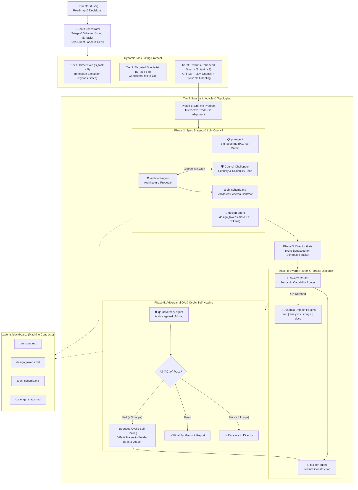

# Wayne Custom Orchestra 🎻

Adaptive Multi-Agent Swarm Orchestrator Architecture & Operating Model (**Wayne Custom 2.0 / Swarms Enhanced**).

---

## 🌟 Overview

**Wayne Custom Orchestra** provides an intelligent, tier-based multi-agent coordination system for autonomous software development. It fuses high-level architectural direction with decoupled execution through **dynamic task sizing**, **machine-actionable blackboard contracts**, **criteria-mapped adversarial QA**, and architectural primitives from Kye Gomez's **Swarms framework**:

- **Hierarchical Swarms**: Structured delegation from Root Orchestrator to Core Pillars and Worker Plugins.
- **LLM Council (Consensus Gate)**: Adversarial debate (Proposer vs. Security/Scalability Challenger) before locking architectural contracts.
- **Swarm Router**: Semantic and capability-driven router dynamically activating specialized domain plugins on-demand.
- **Mixture of Agents (MoA)**: Context synthesis flowing downstream from PM, Design, and Architecture directly into Builder.
- **Bounded Cyclic Self-Healing**: Automated $\le 3$ iteration feedback cycle between QA Adversary and Builder before escalating to the Director.



---

## 🧬 Swarms Primitives & Topologies

| Swarm Topology | Implementation Mechanism | Workflow Impact |
| :--- | :--- | :--- |
| **Hierarchical Swarm** | `The Orchestrator` $\rightarrow$ Core Pillars $\rightarrow$ Dynamic Plugins | Enforces strict executive oversight with zero direct labor on the root orchestrator. Core pillars lead specialized tracks while dynamic plugins serve as worker nodes. |
| **LLM Council (Consensus Gate)** | Proposer (`architect-agent`) vs. Challenger (`security/scalability lens`) | Activates during Phase 2. System schemas, data models, and API interfaces must withstand rigorous challenge and reach multi-perspective consensus before locking into `arch_schema.md`. |
| **Swarm Router** | Semantic / capability-based dispatcher in Orchestrator | Dynamically provisions plugin subagents (`seo-agent`, `analytics-agent`, `image-agent`, `docs-agent`) strictly when requirements demand them, keeping context concise. |
| **Mixture of Agents (MoA)** | Layered contextual synthesis across blackboard | Outputs from PM, Design, and Architecture are synthesized into machine-readable blackboard contracts that guide `builder-agent` directly. |
| **Bounded Cyclic Self-Healing** | Automated loop (`qa-adversary-agent` $\rightleftharpoons$ `builder-agent`) | If adversarial audit detects failing acceptance criteria (`[AC-xx]`), diffs and failure traces are automatically routed back to Builder for up to **3 iterations** before escalation. |

---

## ⚡ Key Capabilities

### 1. Dynamic Task Sizing ($S_{\text{task}}$)
Complexity is calculated across 5 dimensions:
$$S_{\text{task}} = D + F + A + C + V$$
- **$D$ (Domain Breadth)**: Disciplines required (UI, backend, logic, QA).
- **$F$ (Blast Radius & Volume)**: Files touched and line volume.
- **$A$ (Decision Ambiguity)**: Product & design trade-offs.
- **$C$ (Context Dilution Risk)**: Skillset specialization requirements.
- **$V$ (Verification Rigor)**: Test complexity and failure surface.

### 2. Tier-by-Tier Gating
| Tier | Score Range | Mode | Gating Behavior |
| :--- | :--- | :--- | :--- |
| **Tier 1: Micro / Quick Fix** | $S_{\text{task}} \le 5$ | `Direct Solo` | Mandatory bypass of Grill-Me & approval gates. Direct execution. |
| **Tier 2: Targeted Specialist** | $S_{\text{task}} = 6 - 8$ | `Targeted Dispatch` | Single specialist dispatched. Max 1-question micro-grill if UX/arch fork exists. |
| **Tier 3: Swarms-Enhanced Swarm** | $S_{\text{task}} \ge 9$ | `Wayne Custom Swarm` | Full lifecycle: Grill-Me $\rightarrow$ LLM Council Spec Staging $\rightarrow$ Director Gate $\rightarrow$ Swarm Router Dispatch $\rightarrow$ Adversarial QA with Cyclic Self-Healing. |

> **Automated Task Rule**: For any scheduled or timer-triggered tasks (cron, background alarms), the Director approval gate is **automatically bypassed**.

### 3. The Zero Direct Labor Rule (Tier 3)
For Tier 3 tasks, the root Orchestrator does **no direct code or asset implementation**. It exclusively handles triage, task sizing, LLM Council facilitation, Swarm Router dispatching (`invoke_subagent` with `Workspace: "share"`), self-healing orchestration, and final synthesis.

### 4. Adversarial QA Integrity & Cyclic Remediation
`builder-agent` and `qa-adversary-agent` are strictly decoupled. The builder never audits its own code; the adversary validates line-by-line against numbered Acceptance Criteria (`[AC-xx]`) with concrete evidence. If an issue is flagged, the **Bounded Cyclic Self-Healing Loop** automatically routes the fix up to 3 times before involving the Director.

---

## 👥 Agent Roster & Codified Skill Boundaries

To prevent token waste, context dilution, and role-bleed, every agent in the swarm operates within codified **"Good Enough" skill boundaries** and strict **anti-bloat scopes**.

### Core Pillars
| Agent | Responsibility | Assigned "Good Enough" Skills | Excluded Skills (Anti-Bloat Boundary) | Model Tier | Thinking Effort |
| :--- | :--- | :--- | :--- | :--- | :--- |
| **The Orchestrator** | Triage, sizing, dispatch, synthesis. Zero direct labor in Tier 3. | `dispatching-parallel-agents`, `brainstorming` | All direct implementation, UI styling, code editing | **Pro / Reasoning** | **High** |
| **`pm-agent`** | PRD, acceptance criteria (`[AC-xx]`), user personas. | `writing-plans`, `brainstorming` | Code editing, UI styling, debugging | **`pro`** | **High** |
| **`design-agent`** | Layout architecture, typography, responsive CSS tokens. | `ui-ux-pro-max (tokens only)`, `design-system` | `animate`, `animate-expo`, code implementation | **`pro`** | **Medium–High** |
| **`architect-agent`** | System architecture, API contracts, schema consensus. | Architecture & schema design, API contracts | Frontend CSS, UI styling, browser test tools | **`pro`** | **High** |
| **`builder-agent`** | Feature construction, logic wiring, cyclic repair. | `modern-web-guidance`, `animate`, `systematic-debugging`, `ui-styling` | `brand`, `slides`, `canvas-design`, open-ended design discovery | **`pro`** *(or `flash`)* | **Medium** |
| **`qa-adversary-agent`** | Independent auditor against `[AC-xx]` criteria. | `a11y-debugging`, `chrome-devtools`, `verification-before-completion` | File writing, creative design, feature implementation | **`flash`** *(or `pro`)* | **Low–Medium** |

### Dynamic Domain Plugins (Swarm Router)
| Plugin Agent | Responsibility | Assigned "Good Enough" Skills | Excluded Skills (Anti-Bloat Boundary) | Model Tier | Thinking Effort |
| :--- | :--- | :--- | :--- | :--- | :--- |
| **`seo-agent`** | Public marketing, SEO meta tags, JSON-LD schemas. | Search console, metadata validators, JSON-LD | UI layout, CSS, backend database | **`flash`** | **Low** |
| **`analytics-agent`** | Telemetry tracking, funnels, cohort indicators. | GA4 API, SQL adapters, event taxonomy | Visual design, application code | **`flash`** | **Low** |
| **`image-agent`** | Web asset discovery and custom AI image generation. | `search_web`, `generate_image`, `banner-design` | Code editing, refactoring | **`flash`** | **Low** |
| **`docs-agent`** | Developer documentation, API markdown, changelogs. | Markdown documentation, API markdown | Heavy runtime skills, execution tools | **`flash_lite`** / **`flash`** | **None–Low** |

### 🛡️ Context Bloat Prevention Invariant
- **Token Economy**: Prevents prompt saturation by stripping unnecessary skills, minimizing latency and inference overhead.
- **Attention Preservation**: Constrains agent reasoning strictly to its core domain, eliminating hallucinations or distractions from tangential toolsets.
- **Zero Role-Bleed**: Guarantees distinct separation of concerns—planners plan, designers tokenize, builders code, and adversaries audit.

---

## 🔄 Per-Project Mode Switching

Projects configure their orchestrator mode at any time via [`.agents/orchestrator_mode.json`](file:///.agents/orchestrator_mode.json):

```json
{
  "$schema": "./orchestrator_mode.schema.json",
  "activeMode": "Wayne Custom 2.0"
}
```

Supported modes:
- **`Wayne Custom 2.0`** *(Primary Default)*: Adaptive Swarm with Swarms topologies, dynamic task sizing, shared blackboard, LLM Council gate, and cyclic self-healing QA.
- **`Wayne Custom 3.0: Swarms Enhanced`**: Dedicated Swarms-enhanced alias.
- **`Direct Solo`**: Single-agent pair programming without subagent overhead.
- **`TDD Pair`**: Strict Test-Driven Development (Red-Green-Refactor) pair workflow.

---

## 📁 Repository Structure

```
.
├── .agents/
│   ├── orchestrator_mode.json        # Project mode configuration & Swarm topologies
│   ├── orchestrator_mode.schema.json # JSON Schema for mode validation
│   └── blackboard/                   # Machine-actionable shared contracts
│       └── .gitkeep
├── AGENTS.md                         # Detailed agent directives, lifecycle & topologies
├── .gitignore                        # Git ignore rules
└── README.md                         # Architecture overview, Swarms diagram & docs
```

---

## 📄 License
MIT License.
