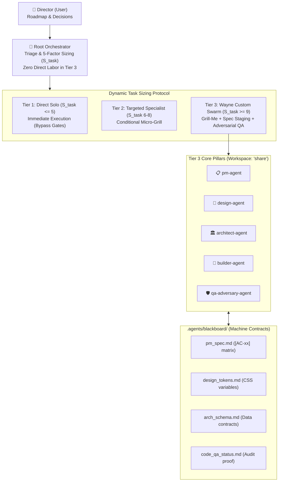

# Wayne Custom Orchestra 🎻

Adaptive Multi-Agent Swarm Orchestrator Architecture & Operating Model (**Wayne Custom 2.0**).

---

## 🌟 Overview

**Wayne Custom Orchestra** provides an intelligent, tier-based multi-agent coordination system for autonomous software development. It bridges high-level architectural direction with decoupled execution through dynamic task sizing, machine-actionable blackboard contracts, and criteria-mapped adversarial QA.



---

## ⚡ Key Capabilities

### 1. Dynamic Task Sizing ($S_{\text{task}}$)
Calculates complexity across 5 dimensions:
$$S_{\text{task}} = D + F + A + C + V$$
- **$D$ (Domain Breadth)**: Disciplines required (UI, backend, logic, QA).
- **$F$ (Blast Radius & Volume)**: Files touched and line volume.
- **$A$ (Decision Ambiguity)**: Product & design trade-offs.
- **$C$ (Context Dilution Risk)**: Skillset requirements.
- **$V$ (Verification Rigor)**: Test complexity and cross-platform surface.

### 2. Tier-by-Tier Gating
| Tier | Score Range | Mode | Gating Behavior |
| :--- | :--- | :--- | :--- |
| **Tier 1: Micro / Quick Fix** | $S_{\text{task}} \le 5$ | `Direct Solo` | Mandatory bypass of Grill-Me & approval gates. |
| **Tier 2: Targeted Specialist** | $S_{\text{task}} = 6 - 8$ | `Targeted Dispatch` | Single specialist dispatched. Max 1-question micro-grill. |
| **Tier 3: Full Multi-Agent Swarm** | $S_{\text{task}} \ge 9$ | `Wayne Custom Swarm` | Full lifecycle: Grill-Me $\rightarrow$ PRD Spec Staging $\rightarrow$ Director Gate $\rightarrow$ Parallel Dispatch $\rightarrow$ Adversarial QA. |

> **Automated Task Rule**: For any scheduled or timer-triggered tasks (cron, background alarms), the approval gate is **automatically bypassed**.

### 3. The Zero Direct Labor Rule (Tier 3)
For Tier 3 tasks, the root Orchestrator does **no direct code or asset implementation**. It exclusively handles triage, decomposition, subagent delegation (`invoke_subagent` with `Workspace: "share"`), and synthesis.

### 4. Adversarial QA Integrity
`builder-agent` and `qa-adversary-agent` are strictly decoupled. The builder never audits its own code; the adversary validates line-by-line against numbered Acceptance Criteria (`[AC-xx]`) with concrete evidence.

---

## 🔄 Per-Project Mode Switching

Projects can configure or switch their orchestrator mode at any time via `.agents/orchestrator_mode.json`:

```json
{
  "$schema": "./orchestrator_mode.schema.json",
  "activeMode": "Wayne Custom 2.0"
}
```

Supported modes:
- **`Wayne Custom 2.0`** *(Primary Default)*: Adaptive Swarm with dynamic sizing, shared blackboard, and adversarial QA.
- **`Direct Solo`**: Single-agent pair programming without subagent overhead.
- **`TDD Pair`**: Strict Test-Driven Development (Red-Green-Refactor) pair workflow.

---

## 📁 Repository Structure

```
.
├── .agents/
│   ├── orchestrator_mode.json        # Project mode configuration
│   ├── orchestrator_mode.schema.json # JSON Schema for mode validation
│   └── blackboard/                   # Machine-actionable shared contracts
│       └── .gitkeep
├── AGENTS.md                         # Detailed agent directives & specifications
├── .gitignore                        # Git ignore rules
└── README.md                         # Architecture overview & documentation
```

---

## 📄 License
MIT License.
