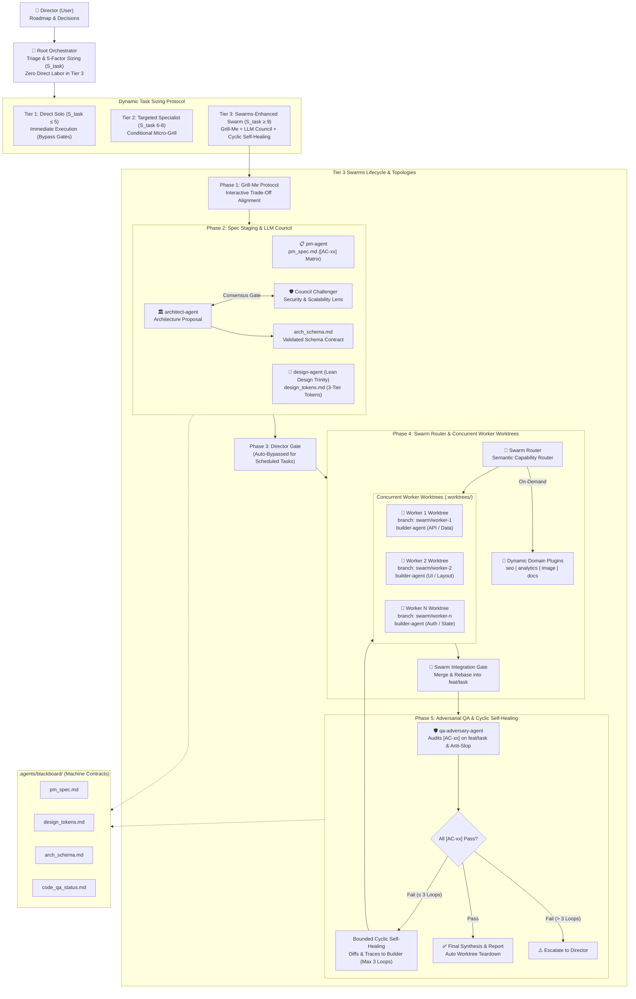

# Wayne Custom Orchestra 🎻

Adaptive Multi-Agent Swarm Orchestrator Architecture & Operating Model (**Wayne Custom 2.0 2026-10-16 / Swarms Enhanced**).

---

## 🌟 Overview

**Wayne Custom Orchestra** provides an intelligent, tier-based multi-agent coordination system for autonomous software development. It fuses high-level architectural direction with decoupled execution through **dynamic task sizing**, **machine-actionable blackboard contracts**, **criteria-mapped adversarial QA**, and architectural primitives from Kye Gomez's **Swarms framework**:

- **Hierarchical Swarms**: Structured delegation from Root Orchestrator to Core Pillars and Worker Plugins.
- **LLM Council (Consensus Gate)**: Adversarial debate (Proposer vs. Security/Scalability Challenger) before locking architectural contracts.
- **Swarm Router**: Semantic and capability-driven router dynamically activating specialized domain plugins on-demand.
- **Cold Catalog & JIT Skill Retrieval**: Curated offline catalog (`.agents/skills/catalog/`) of 2,000+ domain skills (DOCX, PDF, PPTX, XLSX, EPUB, API design, DevOps) searched via `find_skill.py` and mounted just-in-time with 0 root token overhead.
- **Mixture of Agents (MoA)**: Context synthesis flowing downstream from PM, Design, and Architecture directly into Builder.
- **Concurrent Worker Worktrees**: Physical filesystem isolation via Git worktrees (`.worktrees/worker-<id>`) on `swarm/worker-<id>` eliminating file clobbering, git contention, and build lock collisions.
- **Bounded Cyclic Self-Healing**: Automated $\le 3$ iteration feedback cycle between QA Adversary and Builder before escalating to the Director.



---

## 🧬 Swarms Primitives & Topologies

| Swarm Topology | Implementation Mechanism | Workflow Impact |
| :--- | :--- | :--- |
| **Hierarchical Swarm** | `The Orchestrator` $\rightarrow$ Core Pillars $\rightarrow$ Dynamic Plugins | Enforces strict executive oversight with zero direct labor on the root orchestrator. Core pillars lead specialized tracks while dynamic plugins serve as worker nodes. |
| **LLM Council (Consensus Gate)** | Proposer (`architect-agent`) vs. Challenger (`security/scalability lens`) | Activates during Phase 2. System schemas, data models, and API interfaces must withstand rigorous challenge and reach multi-perspective consensus before locking into `arch_schema.md`. |
| **Swarm Router** | Semantic / capability-based dispatcher with Cold Catalog JIT Retrieval | Dynamically provisions plugin subagents (`seo-agent`, `analytics-agent`, `image-agent`, `docs-agent`) and queries `.agents/scripts/find_skill.py` to mount specialized domain skills (docx, pdf, pptx, xlsx) just-in-time, keeping root context at 0 token overhead. |
| **Mixture of Agents (MoA)** | Layered contextual synthesis across blackboard | Outputs from PM, Design, and Architecture are synthesized into machine-readable blackboard contracts that guide `builder-agent` directly. |
| **Concurrent Worker Worktrees** | Isolated Git worktrees (`.worktrees/worker-<id>`) on `swarm/worker-<id>` | Activates in Phase 4. Prevents git index contention, compiler cache locks, and file clobbering across concurrent builder instances before merging through the integration gate. |
| **Bounded Cyclic Self-Healing** | Automated loop (`qa-adversary-agent` $\rightleftharpoons$ `builder-agent`) | If adversarial audit detects failing acceptance criteria (`[AC-xx]`), diffs and failure traces are automatically routed back to Builder for up to **3 iterations** before escalation. |

---

## ⚡ Key Capabilities

### 1. Dynamic Task Sizing ($S_{\text{task}}$)
Complexity is calculated across 5 dimensions:
$$S_{\text{task}} = D + F + A + C + V$$
- **$D$ (Domain Breadth)**: Disciplines required (UI, backend, logic, QA).
- **$F$ (Blast Radius & Volume)**: Files touched and line volume.
- **$A$ (Decision Ambiguity)**: Product & design trade-offs.
- **$C$ (Context Dilution Risk)**: Skillset specialization requirements.
- **$V$ (Verification Rigor)**: Test complexity and failure surface.

### 2. Tier-by-Tier Gating
| Tier | Score Range | Mode | Gating Behavior |
| :--- | :--- | :--- | :--- |
| **Tier 1: Micro / Quick Fix** | $S_{\text{task}} \le 5$ | `Direct Solo` | Mandatory bypass of Grill-Me & approval gates. Direct execution. |
| **Tier 2: Targeted Specialist** | $S_{\text{task}} = 6 - 8$ | `Targeted Dispatch` | Single specialist dispatched. Max 1-question micro-grill if UX/arch fork exists. |
| **Tier 3: Swarms-Enhanced Swarm** | $S_{\text{task}} \ge 9$ | `Wayne Custom Swarm` | Full lifecycle: Grill-Me $\rightarrow$ LLM Council Spec Staging $\rightarrow$ Director Gate $\rightarrow$ Swarm Router Dispatch $\rightarrow$ Adversarial QA with Cyclic Self-Healing. |

> **Automated Task Rule**: For any scheduled or timer-triggered tasks (cron, background alarms), the Director approval gate is **automatically bypassed**.

### 3. The Zero Direct Labor Rule (Tier 3)
For Tier 3 tasks, the root Orchestrator does **no direct code or asset implementation**. It exclusively handles triage, task sizing, LLM Council facilitation, Swarm Router dispatching (`invoke_subagent` with `Workspace: "share"`), self-healing orchestration, and final synthesis.

### 4. Adversarial QA Integrity, Anti-Slop Gating & Cyclic Remediation
`builder-agent` and `qa-adversary-agent` are strictly decoupled. The builder never audits its own code; the adversary validates line-by-line against numbered Acceptance Criteria (`[AC-xx]`) with concrete evidence and executes `impeccable detect (anti-slop audit)` to gate against visual anti-patterns, generic AI templates, and contrast defects. If an issue is flagged, the **Bounded Cyclic Self-Healing Loop** automatically routes the fix up to 3 times before involving the Director.

### 5. Concurrent Worker Worktree Protocol
When parallel implementation spans multiple builders or independent modules, the Orchestrator enforces filesystem isolation:
1. **Spec-Driven Task Partitioning**: Numbered acceptance criteria (`[AC-xx]`) are partitioned into orthogonal domains (API, UI, Auth, etc.).
2. **Worktree Provisioning**: Each concurrent builder instance is allocated a dedicated worktree under `.worktrees/worker-<id>` on branch `swarm/worker-<id>`.
3. **Concurrent Execution**: Subagents run concurrently via `invoke_subagent`, operating strictly within their designated worktrees to eliminate file clobbering, build cache lockups, and git index contention.
4. **Automated Swarm Integration Gate**: Worker branches are merged or rebased into the integration branch `feat/<task>`, ensuring structural and integration integrity.
5. **Phase 5 QA & Teardown**: `qa-adversary-agent` audits the integrated branch. Once all criteria pass, worktrees are automatically cleaned up (`git worktree remove --force`).

### 6. Cold Catalog & Just-in-Time (JIT) Skill Retrieval
To prevent prompt context bloat while supporting thousands of specialized file formats, protocols, and workflows (e.g. Word `.docx`, PDF forms, Excel `.xlsx`, EPUB publishing, OpenAPI schemas, GitHub Actions, Kubernetes), the workspace implements a two-tier **Cold Catalog & Just-in-Time (JIT) Retrieval Architecture**:

1. **Cold Storage Catalog (`.agents/skills/catalog/`)**:
   - Monolithic domain skills reside cold on disk and in curated `index.json`, completely excluded from agent prompt contexts.
   - Offline starter skills (`docx`, `pdf`, `pptx`, `_template`) are pre-cached locally for offline speed.
2. **Fast Semantic Search (`find_skill.py`)**:
   - The Orchestrator or Swarm Router queries `.agents/scripts/find_skill.py` via CLI to find matching skills without loading them into memory:
   ```bash
   # Search for domain capabilities
   python3 .agents/scripts/find_skill.py docx
   python3 .agents/scripts/find_skill.py --category devops
   python3 .agents/scripts/find_skill.py --fetch pptx
   ```
3. **Dynamic Subagent Mounting**:
   - Discovered skills are mounted strictly into the target subagent's prompt and workspace during `invoke_subagent`:
   ```python
   invoke_subagent(
       TypeName="docs-agent",
       Role="Docs (DOCX Specialist)",
       Workspace="share",
       Prompt="Follow domain skill instructions at .agents/skills/catalog/docx/SKILL.md to execute the task."
   )
   ```
4. **Zero Direct Root Token Overhead**:
   - Root Orchestrator and Core Pillars maintain **0 token overhead** from specialized skills, ensuring full cognitive capacity and attention preservation for coordination.

---

## 👥 Agent Roster & Codified Skill Boundaries

To prevent token waste, context dilution, and role-bleed, every agent in the swarm operates within codified **"Good Enough" skill boundaries** and strict **anti-bloat scopes**.

### Core Pillars (Always Active in Tier 3 Swarms)
| Agent | Dedicated Spec | Responsibility | Assigned "Good Enough" Skills | Excluded Skills (Anti-Bloat Boundary) | Model Tier | Thinking Effort |
| :--- | :--- | :--- | :--- | :--- | :--- | :--- |
| **The Orchestrator** | *Root Master Blueprint* | Triage, sizing, dispatch, synthesis. Zero direct labor in Tier 3. | `dispatching-parallel-agents`, `brainstorming` | All direct implementation, UI styling, code editing | **Pro / Reasoning** | **High** |
| **`pm-agent`** | [`pm-agent/AGENTS.md`](.agents/roster/pm-agent/AGENTS.md) | PRD, acceptance criteria (`[AC-xx]`), user personas. | `writing-plans`, `brainstorming` | Code editing, UI styling, debugging | **`pro`** | **High** |
| **`design-agent`** | [`design-agent/AGENTS.md`](.agents/roster/design-agent/AGENTS.md) | Layout architecture, typography, responsive CSS tokens. | `impeccable`, `design-system`, `ui-ux-pro-max (query-only)` | `animate`, `animate-expo`, `emil-design-eng`, `ui-styling`, code implementation, `brand`, `slides`, `banner-design` | **`pro`** | **Medium–High** |
| **`architect-agent`** | [`architect-agent/AGENTS.md`](.agents/roster/architect-agent/AGENTS.md) | System architecture, API contracts, schema consensus. | Architecture & schema design, API contracts | Frontend CSS, UI styling, browser test tools | **`pro`** | **High** |
| **`builder-agent`** | [`builder-agent/AGENTS.md`](.agents/roster/builder-agent/AGENTS.md) | Feature construction, logic wiring, cyclic repair. | `ui-styling`, `modern-web-guidance`, `animate`, `systematic-debugging` | `brand`, `slides`, `canvas-design`, open-ended design discovery | **`pro`** *(or `flash`)* | **Medium** |
| **`qa-adversary-agent`** | [`qa-adversary-agent/AGENTS.md`](.agents/roster/qa-adversary-agent/AGENTS.md) | Independent auditor against `[AC-xx]` & anti-slop gate. | `a11y-debugging`, `chrome-devtools`, `verification-before-completion`, `impeccable detect (anti-slop audit)` | File writing, creative design, feature implementation | **`flash`** *(or `pro`)* | **Low–Medium** |

### 🎨 The Lean Design Trinity & Anti-Slop Architecture
The frontend workflow leverages a streamlined, decoupled design stack to achieve bespoke visual quality without saturating prompt context:
- **`impeccable`**: Provides taste, aesthetic direction, optical typography scales, OKLCH color palettes, and anti-AI slop heuristics.
- **`design-system`**: Emits strict 3-tier token contracts (`primitive` &rarr; `semantic` &rarr; `component`) into `design_tokens.md`.
- **`ui-ux-pro-max (query-only)`**: Query-only reference tool for instant CLI lookup (`python -m uipro ...`), keeping massive style guides out of the model prompt context.
- **Zero Role-Bleed**: Runtime markup and animations are strictly owned by `builder-agent` (`ui-styling`, `animate`), while `qa-adversary-agent` runs `impeccable detect` to mechanically catch AI design slop and visual regressions.

### Dynamic Domain Plugins (Swarm Router)
| Plugin Agent | Dedicated Spec | Responsibility | Assigned "Good Enough" Skills | Excluded Skills (Anti-Bloat Boundary) | Model Tier | Thinking Effort |
| :--- | :--- | :--- | :--- | :--- | :--- | :--- |
| **`seo-agent`** | [`seo-agent/AGENTS.md`](.agents/roster/seo-agent/AGENTS.md) | Public marketing, SEO meta tags, JSON-LD schemas. | Search console, metadata validators, JSON-LD | UI layout, CSS, backend database | **`flash`** | **Low** |
| **`analytics-agent`** | [`analytics-agent/AGENTS.md`](.agents/roster/analytics-agent/AGENTS.md) | Telemetry tracking, funnels, cohort indicators. | GA4 API, SQL adapters, event taxonomy | Visual design, application code | **`flash`** | **Low** |
| **`image-agent`** | [`image-agent/AGENTS.md`](.agents/roster/image-agent/AGENTS.md) | Web asset discovery and custom AI image generation. | `search_web`, `generate_image`, `banner-design`, `brand (visual assets)`, `canvas-design` | Code editing, refactoring | **`flash`** | **Low** |
| **`docs-agent`** | [`docs-agent/AGENTS.md`](.agents/roster/docs-agent/AGENTS.md) | Lead Technical Writer, Lean Documentation Trinity (Diátaxis, typed API contracts, C4 diagrams, SemVer changelogs, ADRs). | `diataxis-framework`, `api-documenter`, `c4-mermaid-diagrams` | `runtime execution`, `test runners`, `ui-styling`, `code implementation` | **`flash`** *(or `flash_lite`)* | **Medium** *(or `None–Low`)* |

### 📚 The Lean Documentation Trinity & Technical Writing Architecture
Technical documentation is authored by `docs-agent` adhering strictly to the **Lean Documentation Trinity**:
- **`diataxis-framework`**: Structured 4-quadrant information architecture (Tutorials, How-To Guides, Reference, Explanation), ensuring documentation addresses specific developer needs without mixed-mode confusion.
- **`api-documenter`**: Extracts type-safe API contracts directly from code, Zod schemas, and `arch_schema.md`—generating typed JSON payloads, exhaustive HTTP error matrices (400, 401, 403, 404, 409, 422, 429, 500), and copy-pasteable multi-language snippets (`curl`, TypeScript, Python).
- **`c4-mermaid-diagrams`**: Renders GitHub-native Mermaid C4 diagrams (Context, Container, Component, and Sequence flows) directly in markdown, giving developers instant visual orientation.
- **Zero Role-Bleed**: Documentation and diagrams only. Never compiles runtimes, executes tests, or modifies UI code.

### 🛡️ Context Bloat Prevention Invariant
- **75% Prompt Context Reduction**: By replacing bloated style dumps and unstructured doc dumps with the Lean Design Trinity (`impeccable` + `design-system` + `ui-ux-pro-max (query-only)`) and Lean Documentation Trinity (`diataxis-framework` + `api-documenter` + `c4-mermaid-diagrams`), token overhead is reduced by ~75%.
- **Token Economy**: Prevents prompt saturation by stripping unnecessary skills, minimizing latency and inference overhead.
- **Attention Preservation**: Constrains agent reasoning strictly to its core domain, eliminating hallucinations or distractions from tangential toolsets.
- **Zero Role-Bleed**: Guarantees distinct separation of concerns—planners plan, designers tokenize, builders code and style, adversaries audit and detect anti-patterns, and technical writers author Diátaxis documentation and C4 diagrams.

---

## 🔄 Per-Project Mode Switching

Projects configure their orchestrator mode at any time via [`.agents/orchestrator_mode.json`](file:///.agents/orchestrator_mode.json):

```json
{
  "$schema": "./orchestrator_mode.schema.json",
  "activeMode": "Wayne Custom 2.0 2026-10-16"
}
```

> [!IMPORTANT]
> **Version Naming Invariant**:
> Whenever the Orchestrator is updated, the active mode name MUST be updated to:
> `Wayne Custom 2.0 <DateOfUpdate>` (e.g. `Wayne Custom 2.0 2026-10-16`).

Supported modes:
- **`Wayne Custom 2.0 2026-10-16`** *(Primary Default)*: Adaptive Swarm with Swarms topologies, dynamic task sizing, modular agent roster (`.agents/roster/`), shared blackboard, LLM Council gate, and cyclic self-healing QA.
- **`Direct Solo`**: Single-agent pair programming without subagent overhead.
- **`TDD Pair`**: Strict Test-Driven Development (Red-Green-Refactor) pair workflow.

---

## 📈 Mandatory Token & Model Telemetry Protocol

To maintain complete transparency into inference economics, verify model routing integrity, and measure token velocity, Wayne Custom 2.0 2026-10-16 enforces a multi-level **Token & Model Telemetry Reporting Protocol**:

1. **Subagent Level**: Every subagent reports its actual assigned Model and token consumption metrics (`Input Tokens`, `Output Tokens`, `Cache Read Tokens`, `Total Tokens`) in its final completion message to the caller via `send_message`.
2. **Root Orchestrator Level**: The Root Orchestrator executes [`.agents/scripts/collate_telemetry.py`](file:///.agents/scripts/collate_telemetry.py) to parse all active session transcripts, aggregating token metrics across all active subagents and the root orchestrator.
3. **Collated Telemetry Summary**: The Root Orchestrator embeds the collated Markdown table in its completion response to the Director.

### 📊 Collated Execution & Token Telemetry Table Example:

| Agent / Level | Model Used | Input Tokens | Output Tokens | Cache Read Tokens | Total Tokens |
| :--- | :--- | :--- | :--- | :--- | :--- |
| Root Orchestrator | Gemini 3.8 Pro (High) | 20,870 | 4,058 | 1,398,943 | 1,423,871 |
| Subagent (`System Architect`) | Gemini 3.8 Flash (High) | 162,722 | 26,517 | 3,320,513 | 3,509,752 |
| **Total (Run Sum)** | **-** | **183,592** | **30,575** | **4,719,456** | **4,933,623** |

### 🛠️ CLI Telemetry Collator Utility

You can generate telemetry reports anytime using the bundled Python script:

```bash
# Auto-detect latest run and collate across all active agents
python3 .agents/scripts/collate_telemetry.py

# Target specific conversation ID
python3 .agents/scripts/collate_telemetry.py --root <ROOT_CONVERSATION_ID>

# Output structured JSON for telemetry dashboards
python3 .agents/scripts/collate_telemetry.py --format json
```

---

## 📁 Repository Structure

```
.
├── .agents/
│   ├── orchestrator_mode.json        # Project mode configuration & Swarm topologies
│   ├── orchestrator_mode.schema.json # JSON Schema for mode validation
│   ├── blackboard/                   # Machine-actionable shared contracts
│   │   └── .gitkeep
│   ├── roster/                       # Modular agent directives & specifications
│   │   ├── pm-agent/AGENTS.md
│   │   ├── design-agent/AGENTS.md
│   │   ├── architect-agent/AGENTS.md
│   │   ├── builder-agent/AGENTS.md
│   │   ├── qa-adversary-agent/AGENTS.md
│   │   ├── seo-agent/AGENTS.md
│   │   ├── analytics-agent/AGENTS.md
│   │   ├── image-agent/AGENTS.md
│   │   └── docs-agent/AGENTS.md
│   ├── scripts/                      # Orchestration utilities
│   │   ├── collate_telemetry.py      # Telemetry collation utility
│   │   └── find_skill.py             # JIT skill search & retrieval utility
│   └── skills/                       # Workspace & Cold Catalog skills
│       ├── catalog/                  # Cold Storage catalog (JIT retrieval)
│       │   ├── index.json            # Curated catalog index (2,000+ skills)
│       │   ├── _template/SKILL.md    # Offline starter template
│       │   ├── docx/SKILL.md         # Word OOXML processing skill
│       │   ├── pdf/SKILL.md          # PDF extraction & form filling skill
│       │   ├── pptx/SKILL.md         # PowerPoint deck engineering skill
│       │   └── downloads/            # Dynamic downloads directory (gitignored)
│       └── impeccable/               # Active core frontend skill
├── .worktrees/                       # Ephemeral agent worktrees (gitignored)
├── AGENTS.md                         # Master Orchestrator Blueprint, lifecycle & topologies
├── .gitignore                        # Git ignore rules (includes .worktrees/ & downloads/)
└── README.md                         # Architecture overview, Swarms diagram & docs
```

---

## 📄 License
MIT License.
