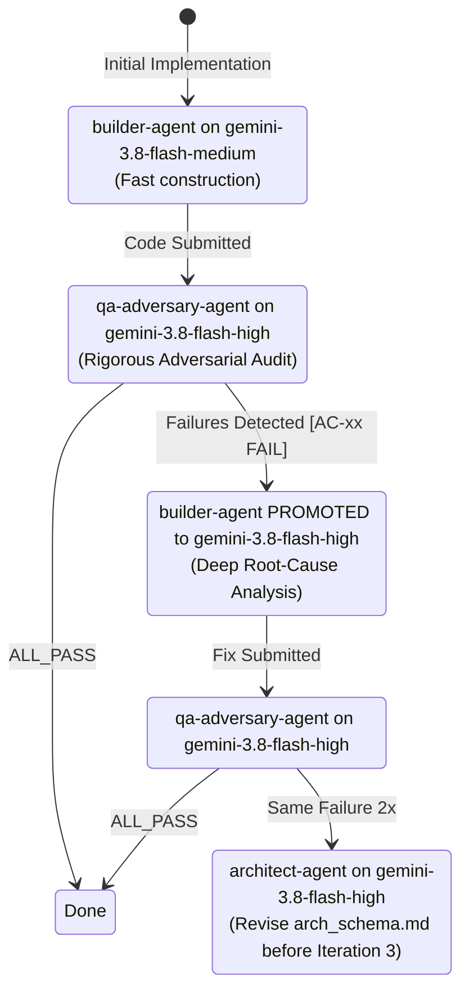

# Wayne Custom Orchestra (Wayne Custom 3.0 / Native Swarm Hybrid)

Adaptive Multi-Agent Swarm Orchestrator Architecture & Operating Model.

## 1. Dynamic Task Sizing Protocol ($S_{\text{task}}$)

Calculate complexity score across 5 dimensions:
$$S_{\text{task}} = D + F + A + C + V$$

- **$D$ (Domain Breadth)**: 1 = single domain, 2 = two domains, 3 = $\ge 3$ domains.
- **$F$ (Blast Radius & Volume)**: 1 = $\le 1$ file / $\le 50$ lines, 2 = 1–2 files / 50–200 lines, 3 = $\ge 3$ files / $\ge 200$ lines.
- **$A$ (Decision Ambiguity)**: 1 = deterministic/zero ambiguity, 2 = minor trade-offs, 3 = open spec/0-to-1 design.
- **$C$ (Context Dilution Risk)**: 1 = 0–1 general skill, 2 = 2 distinct skills, 3 = $\ge 3$ heavy skillsets.
- **$V$ (Verification Rigor)**: 1 = simple eyeball, 2 = unit test / single flow check, 3 = cross-platform / state assertions.

### Tier-by-Tier Gating Table
| Tier | Score Range | Mode | Gating Behavior |
| :--- | :--- | :--- | :--- |
| **Tier 1: Micro / Quick Fix** | $S_{\text{task}} \le 7$ | `Direct Solo` | Mandatory bypass of Grill-Me & approval gates. Direct execution. |
| **Tier 2: Targeted Specialist** | $S_{\text{task}} = 8 - 10$ | `Targeted Dispatch` | Single specialist dispatched. Max 1-question micro-grill if UX/arch fork exists. |
| **Tier 3: Swarms-Enhanced Swarm** | $S_{\text{task}} \ge 11$ | `Wayne Custom Swarm` | Full lifecycle: Grill-Me $\rightarrow$ LLM Council Spec Staging $\rightarrow$ Director Gate $\rightarrow$ Swarm Router Dispatch $\rightarrow$ Adversarial QA with Cyclic Self-Healing. |

> **Automated Task Safety Rule**: For any scheduled or timer-triggered tasks (cron, background alarms), the Director approval gate is bypassed ONLY if $S_{\text{task}} \le 10$ (Tier 1 or Tier 2). Tier 3 swarms triggered via unattended timers are automatically constrained to a **50,000 token spend ceiling** and a **maximum of 1 self-healing repair cycle**; if unpassed criteria remain, execution safely pauses for Director review.

## 2. Programmatic Enforcement & Architecture Taxonomy

All capabilities are delineated into two operational classes:

| Class | Mechanism Type | Enforcing Artifact / Tool | Failure Behavior |
| :--- | :--- | :--- | :--- |
| **Code-Enforced** | Deterministic CLI scripts, Git hooks, filesystem locks | `worktree_helper.sh`, `validate_blackboard.py`, `healing_tracker.py`, `collate_telemetry.py`, `on_session_start.py` (`hooks.json`) | Hard exit code $\ne 0$; blocks subsequent phases loudly. |
| **Prompt-Guided** | Cognitive role directives, persona constraints, thinking depth | Agent system prompts (`agents/*.md`), skill guides (`skills/*/SKILL.md`) | Probabilistic; monitored via adversarial review and linter audits (`audit_orchestrator.py`). |

### Programmatic Enforcement Tooling
- **Git Worktree Isolation**: Managed via `scripts/worktree_helper.sh {add|sync|merge|remove}`.
- **Contract Parity Validation**: Enforced via `scripts/validate_blackboard.py`.
- **Bounded Cyclic Self-Healing**: Managed via `scripts/healing_tracker.py {init|record|status}`.
- **Swarm Orchestrator & Channel Manager**: Managed via `scripts/swarm_orchestrator.py` (automates multi-channel provisioning, brief generation, persona loading, workspace sharing, and spending limits).
- **System Parity Linter**: Verified via `scripts/audit_orchestrator.py`.
- **Telemetry Aggregation**: Processed via `scripts/collate_telemetry.py`.
- **JIT Skill Retrieval**: Queried via `scripts/find_skill.py`.

## 3. Swarms Architectural Primitives & Topologies
- **Hierarchical Swarm**: Root Orchestrator (Zero Direct Labor) directs and routes; specialized core pillars execute; domain plugins handle discrete tasks.
- **LLM Council / Consensus Gates**:
  - **Technical Architecture Council**: Proposer (`architect-agent`) vs. Challenger (`council-challenger`). Schemas, DB models, and API contracts achieve consensus (`[CONSENSUS_ACHIEVED]`) before commit into `arch_schema.md`.
  - **2-Person Design Studio (Pre-Build Craft Gate)**: Proposer (`design-agent`) vs. Art Director Challenger (`design-critic`). Draft design tokens must explore 3 directions, eradicate AI slop, and achieve sign-off (`[DESIGN_CONSENSUS_LOCKED]`) into `design_tokens.md` before builder implementation.
- **Hybrid Research Cluster**: Dynamic intelligence sprint (`research-agent` lead, `social-forum-agent` for Reddit/HN/X/Telegram, `media-intel-agent` for Shorts/TikTok/Bilibili/Reels).
- **Swarm Router**: Semantic, on-demand dispatching to domain plugins (`research-agent`, `social-forum-agent`, `media-intel-agent`, `seo-agent`, `analytics-agent`, `image-agent`, `docs-agent`).
- **Mixture of Agents (MoA)**: Upstream specs (`research_dossier.md`, `pm_spec.md`, `design_tokens.md`, `arch_schema.md`) are synthesized and injected into `builder-agent`.
- **Bounded Cyclic Self-Healing**: Automated feedback loop (`qa-adversary-agent` $\rightleftharpoons$ `builder-agent`) with up to 3 repair cycles before escalation.

## 4. The Zero Direct Labor Rule (Tier 3)
For Tier 3 tasks, the root Orchestrator does **zero direct code or asset implementation**. It exclusively handles triage, decomposition, subagent delegation (`invoke_subagent` or native `swarm` tools with `Workspace: "share"`), self-healing orchestration, and synthesis.

## 5. Shared Blackboard Contracts (`.agents/blackboard/`)
- `research_dossier.md`: Cross-lingual intelligence, native query matrices, video transcripts/comments, and empirical findings.
- `pm_spec.md`: Numbered Acceptance Criteria matrix (`[AC-xx]`), user personas, edge cases.
- `design_tokens.md`: Drop-in CSS variables, color palettes, spacing scales, themed browser surfaces, locked via `[DESIGN_CONSENSUS_LOCKED]` by the 2-Person Design Studio.
- `arch_schema.md`: System architecture, API contracts, DB schemas, state trees approved by LLM Council (`[CONSENSUS_ACHIEVED]`).
- `code_qa_status.md`: Line-by-line audit proof against `[AC-xx]` with concrete verification evidence.

## 6. Hybrid Native Swarm Execution Mode ($S_{\text{task}} \ge 11$)

For Tier 3 tasks, Wayne Custom Orchestra activates the **Hybrid Native Swarm Execution Mode**, coupling Wayne's rigorous machine blackboard contracts and cognitive tiering with Antigravity Native Swarm's pub/sub message board, workstream channels, shared workspaces, and live UI visualization.

### Topic-Based Channel Architecture
To prevent context dilution and subagent noise, execution is decoupled across dedicated topic channels managed by `scripts/swarm_orchestrator.py`:

```
┌────────────────────────────────────────────────────────────────────────┐
│                        Native Swarm Message Board                      │
│                                                                        │
│   #council            #builders                       #qa             │
│   ┌──────────────┐    ┌─────────────────────────┐     ┌──────────────┐ │
│   │ architect    │    │ builder-api (worktree)  │     │ qa-adversary │ │
│   │ challenger   │    │ builder-ui  (worktree)  │     │ (audit &     │ │
│   │ (STRIDE)     │    │ (shared workspace &     │     │  healing)    │ │
│   │ ──────────── │    │  [done] markers)        │     │              │ │
│   │ design-agent │    │                         │     │              │ │
│   │ design-critic│    │                         │     │              │ │
│   │ (Craft Gate) │    │                         │     │              │ │
│   └──────────────┘    └─────────────────────────┘     └──────────────┘ │
│                               ▲                              │         │
│                               └─────── repair feedback ──────┘         │
└────────────────────────────────────────────────────────────────────────┘
```

1. **`#council` (Phases 1 & 2 — Spec Staging & LLM Council Debate)**:
   - Dedicated channel for `pm-agent`, `architect-agent`, `council-challenger`, `design-agent`, and `design-critic`.
   - **Technical Council**: Proposer (`architect-agent`) stages system topology and Zod schemas against `pm_spec.md`; Challenger (`council-challenger`) conducts adversarial STRIDE threat modeling, concurrency hazard scans, and scalability stress tests. Debate is strictly bounded ($\le 2$ exchanges) to prevent circular argument; locks into `arch_schema.md` upon consensus (`[CONSENSUS_ACHIEVED]`).
   - **2-Person Design Studio (Pre-Build Craft Gate)**: Proposer (`design-agent`) formulates 3 distinct aesthetic directions and stages token architecture; Art Director Challenger (`design-critic`) strictly audits Anti-Slop Hard Bans, mandatory craft invariants (themed browser surfaces, asymmetric layout hierarchy), and WCAG AAA/AA contrast. Locks into `design_tokens.md` upon consensus (`[DESIGN_CONSENSUS_LOCKED]`).
   - **Pre-Build Gate Invariant**: `builder-agent` in Phase 4 is blocked from beginning implementation until both `[CONSENSUS_ACHIEVED]` and `[DESIGN_CONSENSUS_LOCKED]` are confirmed on disk.

2. **`#builders` (Phase 4 — Concurrent Worker Implementation)**:
   - Dedicated channel for parallel builder workers (`builder-api`, `builder-ui`, etc.).
   - Workers execute with shared workspace access (`workspace: "share"`) and physical isolation in Git worktrees (`.worktrees/worker-<id>` on branch `swarm/worker-<id>`).
   - Workers communicate progress via targeted `@mention` syntax and complete tasks with standard `[done]` prefix markers.

3. **`#qa` (Phase 5 — Adversarial Audit & Bounded Cyclic Self-Healing)**:
   - Dedicated channel for `qa-adversary-agent` operating on cognitive parity (`Model: "gemini-3.8-flash-high"`).
   - Mechanically verifies merged code on `feat/<task>` against every acceptance criterion in `pm_spec.md`.
   - On defects, posts targeted failure reports (criterion ID, reproduction command, stack trace) directly to `#qa` tagging the responsible builder.
   - Orchestrated via `scripts/healing_tracker.py` with maximum 3 repair iterations and Regression Lock enforcement.

### Native Auxiliary Roles
1. **`narrator` (Live Visual Overview UI)**:
   - Maintains the real-time visual Overview dashboard in the Antigravity Swarm UI for the Director.
   - Synthesizes the active lifecycle phase, $S_{\text{task}}$ score, passing/failing `[AC-xx]` count, and healing iteration count ($N/3$) without clogging developer logs.
   - Assigned Model: `gemini-3.8-flash-low` (minimal thinking budget saving up to 80% auxiliary quota).
2. **`monitor` (Stall Watchdog & Deadlock Breaker)**:
   - Continuously monitors worker turn durations and message board liveness.
   - Alerts the Root Orchestrator if builds, test runs, or channel handoffs hang or exceed reasonable operational thresholds.
   - Assigned Model: `gemini-3.8-flash-low` (high-frequency quota preservation).

### Brief Generator & Channel Manager (`scripts/swarm_orchestrator.py`)
- Programmatic CLI helper that provisions topic channels (`#council`, `#builders`, `#qa`), formats standardized, persona-bound worker briefs, sets up channel subscriptions, model tier pinning (`gemini-3.8-flash-high`, `gemini-3.8-flash-medium`, `gemini-3.8-flash-low`), and workspace sharing flags (`workspace: "share"`).
- Automatically enforces safety ceilings, token spending limits, and clean teardown (`swarm{action: "kill", name: "all"}`) upon lifecycle completion.

## 7. Exclusive Google Gemini Model Architecture & Thinking Tiers

The Wayne Custom Swarm operates exclusively on Google Gemini models (**Gemini 3.8 Flash** across 3 granular thinking tiers with zero non-Google models) to achieve elite cognitive reasoning while preserving operational quota:

### The 3 Thinking Tiers

| Model Identifier | Display Name | Thinking Budget | Primary Characteristics | Cost / Quota Profile |
| :--- | :--- | :---: | :--- | :--- |
| **`gemini-3.8-flash-high`** | Gemini 3.8 Flash (High) | **Max / Deep** | Full reasoning scratchpad, multi-turn constraint tracking, formal logic verification, deep AST code analysis, aesthetic craft exploration & critique. | Highest quota burn per turn; reserved for critical consensus gates, design studio, and adversarial audit. |
| **`gemini-3.8-flash-medium`** | Gemini 3.8 Flash (Medium) | **Moderate** | Balanced reasoning, fast component assembly, structured data formatting, standard unit test generation. | Balanced speed and token efficiency for code implementation and forum mining. |
| **`gemini-3.8-flash-low`** | Gemini 3.8 Flash (Low) | **Minimal** | Ultra-low latency, direct deterministic instruction execution, text formatting, and template expansion. | Lowest quota burn; ideal for auxiliary roles, static metadata, and documentation formatting. |

### Agent-to-Model Assignment Matrix

All 14 specialized agents and auxiliary roles are mapped deterministically across the 3 tiers:

```
┌────────────────────────────────────────────────────────────────────────┐
│ TIER 1: DEEP REASONING & VERIFICATION (gemini-3.8-flash-high)          │
│   ├── architect-agent       (Zod schemas, DB models, STRIDE security)  │
│   ├── council-challenger    (STRIDE stress-tests, race conditions)     │
│   ├── qa-adversary-agent    (Adversarial [AC-xx] line-by-line audit)   │
│   ├── pm-agent              (Acceptance criteria, finite state tables) │
│   ├── research-agent        (Cross-lingual query matrices, provenance) │
│   ├── design-agent          (3-direction exploration, anti-slop craft) │
│   ├── design-critic         (Art Director adversarial craft gate)      │
│   └── builder-agent (Fix)   (Self-healing repair cycles: Iteration 2+) │
├────────────────────────────────────────────────────────────────────────┤
│ TIER 2: BALANCED EXECUTION & LOGIC (gemini-3.8-flash-medium)           │
│   ├── builder-agent (Init)  (Initial feature implementation & logic)   │
│   ├── social-forum-agent    (Reddit / HN / Telegram thread extraction)│
│   ├── media-intel-agent     (Subtitles & ffmpeg keyframe inspection)   │
│   └── analytics-agent       (Telemetry event schemas & SQL metrics)    │
├────────────────────────────────────────────────────────────────────────┤
│ TIER 3: HIGH-SPEED & QUOTA PRESERVATION (gemini-3.8-flash-low)         │
│   ├── docs-agent            (Diátaxis docs, API contracts, C4 diagrams)│
│   ├── seo-agent             (Structured metadata, semantic HTML)       │
│   ├── image-agent           (SVG optimization & image prompts)         │
│   ├── narrator              (Live UI dashboard updates in Antigravity) │
│   └── monitor               (Stall watchdog & deadlock breaker)        │
└────────────────────────────────────────────────────────────────────────┘
```

### Dynamic Gemini Self-Healing Escalation Ladder

Rather than leaving `builder-agent` at a fixed thinking level during debugging, the self-healing feedback loop dynamically steps up the thinking budget:



1. **Iteration 1**: Builder builds with `gemini-3.8-flash-medium` for rapid construction and low latency.
2. **Iteration 2 (If Fail)**: `healing_tracker.py` promotes Builder to **`gemini-3.8-flash-high`** to perform deep algorithmic diagnosis and surgical repair under cognitive parity.
3. **Consecutive Failure (Same Criterion Failed 2x)**: Triggers the Architectural Escalation Gate, pausing `builder-agent` and dispatching `architect-agent` (`gemini-3.8-flash-high`) to modify system schemas or API contracts before attempting Iteration 3.

## 8. Mandatory Response Reporting Invariant
Every response summarizing execution or status updates must include:
> **Execution Telemetry**:
> - **Task Tier**: `Tier 1: Direct Solo` | `Tier 2: Targeted Specialist` | `Tier 3: Full Swarm` (with $S_{\text{task}}$ score)
> - **Swarm Topologies**: [Active topologies]
> - **Agents Employed**: [Active subagents or `None (Direct Solo)`]
